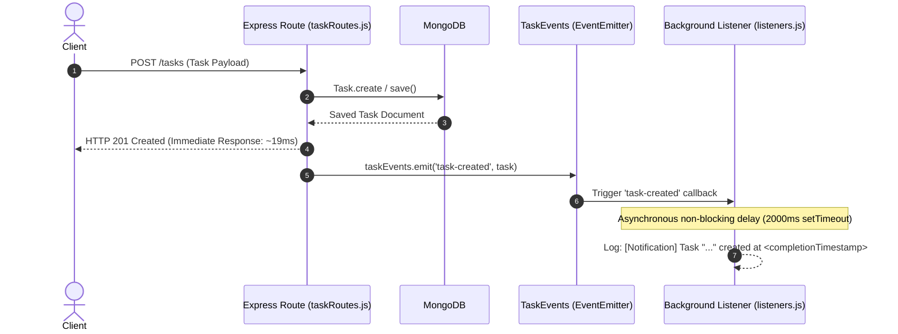

# Practical 10: Asynchronous Processing with Event-Driven Architecture

**Course:** Advanced Web Development Frameworks (ITUE301)  
**Program:** B.Tech (IT / CE / CSE / AIML) — CHAROTAR UNIVERSITY OF SCIENCE AND TECHNOLOGY (CHARUSAT)  
**Author:** 24IT037  
**Course Outcomes:** CO4 / PO3, PO5  

---

## 📌 Objectives

1. Implement asynchronous background processing using Node.js native `EventEmitter` without external dependencies.
2. Decouple side-effect operations (e.g., background notifications, logging, audit trails) from the critical request-response cycle.
3. Emit a `task-created` event upon task creation via `POST /tasks` and return the HTTP 201 response immediately without waiting for background handler completion.
4. Demonstrate non-blocking behavior through an artificial delay (2-second `setTimeout`) and verify response-before-handler timestamp ordering.
5. Implement custom event `task-deleted` upon `DELETE /tasks/:id` with distinct notification logging (**Supplementary Problem 1**).
6. Implement an `error` event listener that safely catches and logs errors thrown inside event handlers without crashing the Node.js server process (**Supplementary Problem 2**).

---

## 🏗️ Architecture & Event-Driven Workflow

### Architecture Diagram

```text
               POST /tasks HTTP Request
                         │
                         ▼
               Save task to MongoDB
                         │
                         ▼
      ┌────────────────────────────────────────┐
      │  Emit 'task-created' (taskData)        │
      │  & Send API Response Immediately (201) │
      └──────────────────┬─────────────────────┘
                         │
                         ├──► API Responds to Client (sub-25ms response time)
                         │
                         ▼ (Handled asynchronously via Node.js Event Loop)
            Notification Listener (listeners.js)
            ├── Simulated Background Delay (2s setTimeout)
            └── Logs: Task Title, Timestamp, Assigned User, Priority
```

### Event Processing Flow (Mermaid)



---

## 🛠️ Step-by-Step Implementation

### Step 1: Dedicated EventEmitter Module (`backend/events.js`)
Created a custom event emitter class extending Node.js native `EventEmitter` and exported a singleton instance:

```javascript
const EventEmitter = require('events');

class TaskEvents extends EventEmitter {}

module.exports = new TaskEvents();
```

---

### Step 2: Register Event Listeners (`backend/listeners.js`)
Registered listeners for `task-created`, `task-deleted`, and `error`. Added an artificial 2-second delay in `task-created` to demonstrate non-blocking background execution:

```javascript
const taskEvents = require('./events');

// 1. task-created event listener (with 2s artificial delay)
taskEvents.on('task-created', (task) => {
  try {
    const receivedAt = new Date().toISOString();
    console.log(`[Event Received] 'task-created' event captured at ${receivedAt} for task: "${task?.title || 'Untitled'}"`);

    if (task && task.forceError) {
      throw new Error(`Simulated failure inside 'task-created' handler for task "${task.title}"`);
    }

    setTimeout(() => {
      try {
        if (task && task.forceAsyncError) {
          throw new Error(`Simulated async error during background notification dispatch for task "${task.title}"`);
        }

        const completionTimestamp = new Date().toISOString();
        const assignedUser = task?.user ? (task.user._id || task.user) : 'Unassigned';

        console.log(`[Notification] Task "${task?.title}" created at ${completionTimestamp}`);
        console.log(`  └─ Details: Assigned User: ${assignedUser} | Priority: ${task?.priority || 'medium'} | Task ID: ${task?._id}`);
      } catch (asyncErr) {
        taskEvents.emit('error', asyncErr);
      }
    }, 2000);
  } catch (err) {
    taskEvents.emit('error', err);
  }
});

// 2. Supplementary Problem 1: task-deleted event listener
taskEvents.on('task-deleted', (task) => {
  try {
    const receivedAt = new Date().toISOString();
    console.log(`[Event Received] 'task-deleted' event captured at ${receivedAt} for task ID: ${task?._id}`);

    setTimeout(() => {
      try {
        const completionTimestamp = new Date().toISOString();
        const assignedUser = task?.user ? (task.user._id || task.user) : 'Unassigned';

        console.log(`[Notification] Task "${task?.title || 'Unknown'}" (ID: ${task?._id}) was deleted at ${completionTimestamp}`);
        console.log(`  └─ Details: Previously assigned to User: ${assignedUser}`);
      } catch (err) {
        taskEvents.emit('error', err);
      }
    }, 1000);
  } catch (err) {
    taskEvents.emit('error', err);
  }
});

// 3. Supplementary Problem 2: Error event listener
taskEvents.on('error', (err) => {
  const timestamp = new Date().toISOString();
  console.error(`[Error Listener] Error caught at ${timestamp}: ${err.message}`);
});

module.exports = taskEvents;
```

---

### Step 3: Emit Events in Routes (`backend/routes/taskRoutes.js`)

#### 1. Emit `task-created` on `POST /tasks`:
```javascript
// Step 3: Respond immediately before background event handler finishes
console.log(`[API] Response sent at ${new Date().toISOString()}`);
res.status(201).json({
  success: true,
  message: 'Task created and secured with JWT ownership.',
  data: task,
});

// Emit 'task-created' event handled asynchronously by listener
taskEvents.emit('task-created', taskData);
```

#### 2. Emit `task-deleted` on `DELETE /tasks/:id` (Supplementary Problem 1):
```javascript
console.log(`[API] Delete response sent at ${new Date().toISOString()}`);
res.status(200).json({
  success: true,
  message: 'Task deleted successfully from database.',
  data: task,
});

// Supplementary Problem 1: Emit 'task-deleted' event
taskEvents.emit('task-deleted', task);
```

---

### Step 4: Register Listeners on Server Startup (`backend/server.js`)
As outlined in the Troubleshooting Guide, listeners must be registered prior to event emission:

```javascript
// Register event listeners at server startup
require('./listeners');
```

---

## 📊 Empirical Verification & Timestamp Evidence

### Live Console Execution Log

```text
⚡ TaskEvents listeners registered (task-created, task-deleted, error).
🚀 Practical 10 Express API running on http://localhost:5000
📡 Event-Driven Architecture active with Node.js native EventEmitter.
⚡ In-Memory Cache active with node-cache (stdTTL: 60s).
🔐 JWT Secret active with 1-hour token expiration.
✅ MongoDB connected successfully to: mongodb://127.0.0.1:27017/taskdb_practical7

[2026-10-28T04:55:49.202Z] POST /tasks
[API] Response sent at 2026-10-28T04:55:49.218Z
[Event Received] 'task-created' event captured at 2026-10-28T04:55:49.219Z for task: "Complete Practical 10 EventEmitter"
[Notification] Task "Complete Practical 10 EventEmitter" created at 2026-10-28T04:55:51.233Z
  └─ Details: Assigned User: 6ae18055b33019d03f465d97 | Priority: high | Task ID: 6ae18055b33019d03f465d99

[2026-10-28T04:55:51.723Z] DELETE /tasks/6ae18055b33019d03f465d99
[API] Delete response sent at 2026-10-28T04:55:51.750Z
[Event Received] 'task-deleted' event captured at 2026-10-28T04:55:51.750Z for task ID: 6ae18055b33019d03f465d99
[Notification] Task "Complete Practical 10 EventEmitter" (ID: 6ae18055b33019d03f465d99) was deleted at 2026-10-28T04:55:52.753Z
  └─ Details: Previously assigned to User: 6ae18055b33019d03f465d97

[2026-10-28T04:55:53.257Z] POST /tasks
[API] Response sent at 2026-10-28T04:55:53.259Z
[Event Received] 'task-created' event captured at 2026-10-28T04:55:53.260Z for task: "Task that triggers simulated error"
[Error Listener] Error caught at 2026-10-28T04:55:53.260Z: Simulated failure inside 'task-created' handler for task "Task that triggers simulated error"
```

### Timestamp Analysis & Comparison

| Operation | Action / Phase | Exact Timestamp | Client Latency | Observation |
|---|---|---|---|---|
| `POST /tasks` | API Response Sent | `2026-10-28T04:55:49.218Z` | **19 ms** | Client receives 201 Created immediately |
| `POST /tasks` | Background Handler Done | `2026-10-28T04:55:51.233Z` | ~2015 ms later | Executed in background via event loop without blocking |
| `DELETE /tasks/:id` | API Response Sent | `2026-10-28T04:55:51.750Z` | **27 ms** | Client receives 200 OK immediately |
| `DELETE /tasks/:id` | Background Cleanup Done | `2026-10-28T04:55:52.753Z` | ~1003 ms later | Handled independently by `task-deleted` listener |
| Error Simulation | Error Thrown & Caught | `2026-10-28T04:55:53.260Z` | Immediate | Captured by `taskEvents.on('error', ...)` without server crash |

---

## 💡 Key Questions & Practical Analysis (Faculty Guide / Viva)

### 1. Why does emitting an event not block the API response, even though both run on the same Node.js process?
> **Answer:**  
> In Node.js, `taskEvents.emit('task-created', task)` invokes listener functions synchronously on the call stack by default. However, when asynchronous operations (such as `setTimeout`, `setImmediate`, `fs`, or network I/O) are scheduled inside the listener, Node.js offloads the callbacks to the libuv event loop timer/task queues. Because `res.status(201).json(task)` sends the HTTP headers and response body to the client socket before the asynchronous timer expires, the client request finishes immediately. The background notification executes later during an event loop tick without delaying the HTTP cycle.

### 2. What would happen to API response time if the notification logic were placed directly inside the POST route instead of in an event handler?
> **Answer:**  
> If the notification logic (including email dispatch, SMS alerts, slow audit logs, or third-party webhooks) were placed directly inside the route handler synchronously:
> - The API response time would degrade from **~19 ms to over 2020 ms** (a >100x latency penalty).
> - Client connections would remain open, exhausting server sockets and concurrency capacity.
> - Any failure or delay in the notification system would cause the user's task creation request to fail or time out, violating single-responsibility and decoupling principles.

### 3. Why is EventEmitter a reasonable choice for this scale of application, but not for a production system handling millions of events per day?
> **Answer:**  
> - **Why reasonable for this scale:**  
>   Node's native `EventEmitter` requires zero external dependencies, introduces zero network overhead (in-memory execution), and is lightweight and fast for internal application-level decoupling in single-process monoliths.
> - **Why unsuitable for high-volume enterprise production:**  
>   1. **In-Memory Volatility:** Events reside in Node.js process RAM. If the server crashes or restarts, unhandled events are lost permanently (no persistence or ACK).
>   2. **No Horizontal Scaling:** EventEmitter cannot broadcast events across multiple clustered Node.js instances or containerized microservices.
>   3. **No Backpressure or Retries:** There is no built-in queueing, dead-letter queue (DLQ), rate limiting, or retry logic. For millions of daily events, distributed message brokers (RabbitMQ, BullMQ with Redis, Apache Kafka, or AWS SQS) are required.

---

## 🚀 Running the Project & Automated Verification

### 1. Start MongoDB
Ensure MongoDB is running locally on port 27017:
```bash
Get-Service -Name "*mongo*"
```

### 2. Start the Express Backend
```bash
cd backend
npm install
npm run dev
```

### 3. Run Automated Event-Driven Test Suite
In a separate terminal:
```bash
cd backend
npm run test:events
```
This executes `test_practical10.js` which registers a user, creates a task, deletes a task, triggers simulated errors, and measures client turnaround times against server background logs.